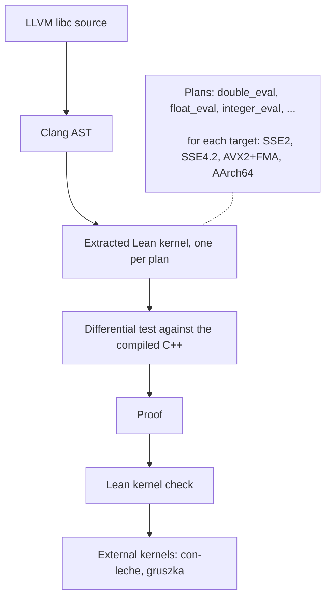
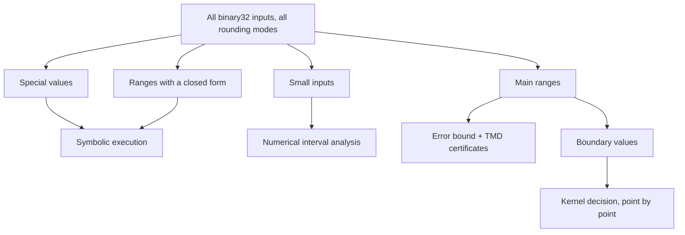

# VerifiedLibc

Lean 4 proofs that LLVM libc math functions are correctly rounded.

## From libc source to a checked proof

The first steps make a Lean model of the C++ code and test it. The last steps prove a statement
about that model and check the proof.



Run the external kernels with `kernel-check <Module> <Theorem>...` in the flake shell, after
`lake build`.

## Setup

The development environment is a Nix flake. It provides Lean 4.36.0 (the official release,
including its bundled C compiler) and the numerical tools used alongside the proofs: Sollya,
Gappa, MPFR, MPFI, and the CaDiCaL, Z3, cvc5 and Bitwuzla solvers. It also builds the external
kernels `con-leche` and `gruszka`, with `lean4export` and `susz` to feed them.

```bash
nix develop          # or `direnv allow`
lake exe cache get   # prebuilt Mathlib
lake build
kernel-check LibcMath.Kernels.Expf.Proof.DoubleEval \
  LibcMath.Kernels.Expf.Proof.DoubleEval.expfDoubleEval_correctlyRounded   # external kernels
```

Lean dependencies are pinned in `lake-manifest.json`:

- [Mathlib](https://github.com/leanprover-community/mathlib4) v4.36.0, for real analysis.
- [FloatLib](https://github.com/lean-dojo/FloatLib) v4.1.0, for IEEE 754 formats, rounding
  theorems and numerical proof automation.

## Repository layout

Each verified math function lives under `LibcMath/Kernels/` as an entry file
`LibcMath/Kernels/<Function>.lean` paired with a directory `LibcMath/Kernels/<Function>/`:

```text
LibcMath/
  Kernels/
    Expf.lean            # start here: each plan, its state, and the name of its theorem
    Expf/
      Generated/         # plans emitted by `ast2lean`; never edited by hand
      Plans.lean         # catalogue of extracted plans
      Statement.lean     # `CorrectlyRounded` statements
      Proof/
        Common.lean      # facts about bit patterns that the plans share
        DoubleEval.lean  # `expfDoubleEval_correctlyRounded` (complete)
        DoubleEval/
          ShortPaths/    # `SymbolicExecution.lean`, and whole ranges in `Ranges.lean`
          MainPath/      # one file per numerical-analysis step, and `Tmd/` certificates
        DoubleEvalFma.lean, StaticRounding.lean, IntegerEval.lean
        DoubleEvalFma/, StaticRounding/, IntegerEval/   # `ShortPaths/` only
      Examples.lean      # worked evaluations and `Libc.Diag` checks
  Libc/                  # shared LLVM libc operations (`FPBits`, `nearestInt`, `horner`, `Diag`, …)
  Analysis/              # reusable numerical analysis (`RangeReduction`, `Horner`, `RoundingTransfer`, `ChebTmd`, …)
  Framework/             # `Spec`, `Specs`, `BitRange`, `Correctness`
  Testing/               # oracles, `checkrange`, and examples
```

See `OPEN.md` (checked by `python3 scripts/check-open.py`) for any open `sorry` obligations,
`templates/FunctionTemplate/` for a copyable skeleton, and
`journal/trees/note/note-adding-a-function.tree` for the step-by-step guide to adding a new
function.

## Changing the Lean version

The Lean version appears in `lean-toolchain` and in `flake.nix` (`leanVersion` and
`leanHashes`); the two must agree. Obtain the hash of a new release with

```bash
nix store prefetch-file https://github.com/leanprover/lean4/releases/download/v<version>/lean-<version>-linux.tar.zst
```

Mathlib and FloatLib each target one Lean release, so move all three together.

## Extracting functions from LLVM libc

Proofs are about the actual LLVM libc implementations, extracted from the Clang AST of the C++
sources into Lean functions over `LibcMath.Libc`. An extracted function returns `Option`: `none`
stands for an execution that reaches an operation C++ leaves undefined (a conversion to an integer
out of range, a table index out of bounds, a shift by the width or more, signed overflow, a
division by zero).

- `extract/` contains **`ast2lean`**, a C++23 module-first (`.cppm`) Clang LibTooling extractor.
- `ast2lean` snapshots active preprocessor flags (`LIBC_MATH_HAS_*`, `LIBC_TARGET_CPU_HAS_*`,
  `LIBC_TYPES_HAS_INT128`, target triple, implementation variant) into a `Libc.MathConfig` and
  `Libc.KernelMeta` record alongside a `Libc.UnaryKernel` bundle.
- `LibcMath/Libc/` defines the shared LLVM libc kernel vocabulary backed by FloatLib: `FPBits`,
  config-aware `multiplyAdd`/`multiplySub`/`subMultiply`, `nearestInt`, `setOverflow`/
  `setUnderflow`, `Frac64`, `NumberPair` (`FloatFloat`/`DoubleDouble`), `TripleDouble`,
  `DyadicFloat`, `ExceptValues`, polymorphic `horner`/`althorner`/`estrin` polynomial DSL
  (`LibcMath.Libc.DSL`), and agent-friendly diagnostics (`LibcMath.Libc.Diag`).

```bash
# Extract a single function
extract/extract.sh <llvm-project>/libc expf math::double_eval::expf expf \
  --namespace=LibcMath.Kernels.Expf.Generated.DoubleEval \
  --out=LibcMath/Kernels/Expf/Generated/DoubleEval.lean

# Inspect active LIBC_MATH / target CPU macros without emitting Lean
./extract/build/ast2lean <llvm-project>/libc/src/math/generic/expf.cpp \
  --function=math::double_eval::expf --dump-config \
  -- -std=gnu++17 -mavx2 -mfma -I <llvm-project>/libc -DLIBC_NAMESPACE=__llvm_libc

# Regenerate all six extracted `expf` evaluation plans under LibcMath/Kernels/Expf/Generated/
extract/extract-expf-plans.sh <llvm-project>/libc
```

The six extracted `expf` evaluation plans under `LibcMath/Kernels/Expf/Generated/` are:

- `DoubleEval`: x86-64 non-FMA double-precision table+Horner (`LIBC_MATH=0`, 4 modes, CR)
- `DoubleEvalFma`: `double_eval` with `-mavx2 -mfma` (hardware FMA + `nearest_integer`, 4 modes, CR)
- `IntegerEval`: pure integer `Frac64` (`LIBC_MATH_EXPF_IMPL=integer_eval`, `LIBC_MATH=0x2C`, RN, CR)
- `StaticRounding`: 4-mode pure integer `Frac64` (`math::static_rounding::expf`, `LIBC_MATH=0x0C`, 4 modes, CR)
- `FloatEval`: fast single-precision Estrin+Horner (`LIBC_MATH=0x3F`, RN, ~1 ULP)
- `FloatEvalCrRn`: GPU `FloatFloat` FMA (`LIBC_MATH=0x3E`, RN, CR)

## What is proved

**`expfDoubleEval_correctlyRounded` (`LibcMath/Kernels/Expf/Proof/DoubleEval.lean`) is
complete.** It proves
`ExpfDoubleEvalCorrectlyRounded` — that `math::double_eval::expf` (x86-64 non-FMA, `LIBC_MATH=0`),
extracted from LLVM libc at `e1a5f92db023`, is correctly rounded across all `2³²` binary32 inputs
in all four rounding directions of C (`cModes`) and reaches no operation that C++ leaves undefined,
using zero `sorry`s, zero `native_decide`, and only the three standard Lean axioms
`[propext, Classical.choice, Quot.sound]`.

| Inputs | Bit patterns | Share | Proof |
|---|---|---|---|
| Zeros, infinities, NaNs, `\|x\| ≤ 2⁻²⁶`, overflow, underflow | 3 749 616 693 | 87.30 % | `Expf/Proof/DoubleEval/ShortPaths/Ranges.lean` |
| Tiny & near-underflow main-path intervals | 25 256 675 | 0.59 % | analytic (`Expf/Proof/DoubleEval/MainPath/ProductError.lean`) |
| Main polynomial ranges (`2⁻²⁴ ≤ x < 88.72…`, `-103.97… < x < -2⁻²⁵`) | 520 093 927 | 12.11 % | value error (`≤ 2 · 10⁻¹⁵ · exp x`) + 278 619 Chebyshev SLZ TMD certificates (`Expf/Proof/DoubleEval/MainPath/Tmd/`) + 103 pointwise exceptions (`Expf/Proof/DoubleEval/MainPath/PointwiseExceptions.lean`) |

Every statement and theorem explicitly names its extracted plan (there is no "default" plan alias).
For `expf`, `expfDoubleEval_correctlyRounded` is complete. Every other plan has a top-level
theorem that ends in an open lemma. The short paths of `double_eval_fma` (87.30 %),
`static_rounding` (87.69 %) and `integer_eval` (87.69 %, through
`integerEval_eq_staticRounding_nearest`) are proved; their main polynomial ranges are open.
`float_eval` is not correctly rounded, so its statement is that it reaches no undefined
operation. `OPEN.md` lists every open lemma.

### How the proof of `expf` (`double_eval`) is built

The proof is a case analysis on the inputs. Each class of inputs is closed by the method that
suits it.



## Testing a kernel

Tests show whether a statement is true before effort goes into proving it. They are not how a
function is proved correct.

```bash
lake build checkrange
.lake/build/bin/checkrange --plan=double_eval nearest 1065353216 1024 512
.lake/build/bin/checkrange --oracle=mpfr --plan=float_eval nearest 1065353216 64
```

`checkrange` runs a kernel on consecutive bit patterns and asks an oracle whether each result is
the correctly rounded one. A failure is reported on stderr with the input, the result and how the
kernel was configured. `--oracle=lean`, the default, is `expOracle`, which is proved sound in
Lean; `--oracle=mpfr` asks MPFR (`c/mpfr_oracle.c`) and is trusted, with that trust stated as the
axiom `MpfrOracle.mpfrExpf_sameValue` in `LibcMath/Testing/Oracle/Mpfr.lean`.

## Testing extracted models against compiled machine code

Differential testing checks that each AST-extracted Lean kernel agrees bit-for-bit (up to NaN)
with `expf.cpp` compiled by Clang with the matching `LIBC_MATH` and CPU flags:

```bash
scripts/difftest-expf.sh --plan=double_eval <llvm-project>/libc quick
scripts/difftest-expf.sh --plan=double_eval_fma <llvm-project>/libc quick
scripts/difftest-expf.sh --plan=integer_eval <llvm-project>/libc quick
scripts/difftest-expf.sh --plan=float_eval <llvm-project>/libc quick
scripts/difftest-expf.sh --plan=float_eval_cr_rn <llvm-project>/libc quick
scripts/difftest-expf.sh --plan=double_eval <llvm-project>/libc dense 51
scripts/difftest-expf.sh --plan=double_eval <llvm-project>/libc range 3F800000 3FFFFFFF
```

`double_eval` and `double_eval_fma` test all four IEEE rounding modes (`nearest`, `up`, `down`,
`zero`); RN-only plans test `nearest`.

## Conventions and journal

`AGENTS.md` has the conventions for changing proofs and running diagnostics. `journal/` is a
[Forester](https://www.forester-notes.org/) forest of dated changes, lessons, open problems,
decisions, and sessions; build and browse it with `journal-serve` from the flake shell.
